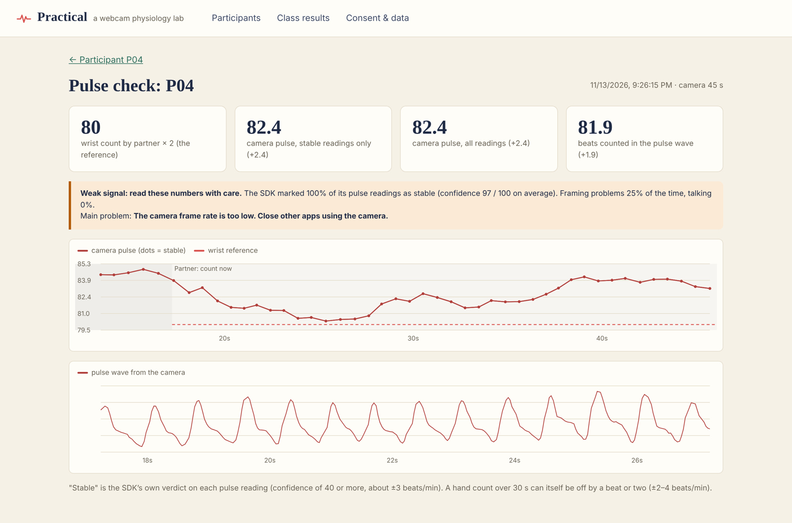
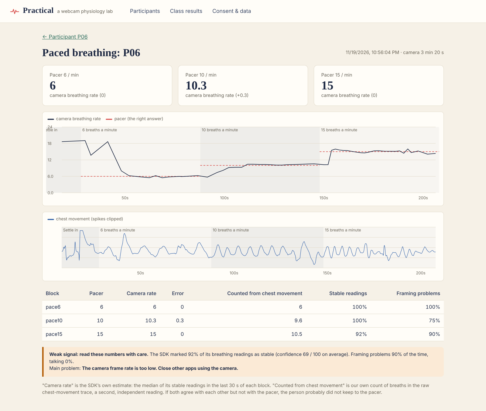

# Practical

**A webcam physiology lab for students who never got one.** Practical runs the classic experiments from a physiology practical (paced breathing, heartbeat counting, mental-arithmetic stress and recovery, and a pulse check against a partner's wrist count) with just a laptop camera, using the [Presage SmartSpectra SDK](https://github.com/Presage-Security/SmartSpectra).

Every experiment has a known right answer (the pacer rate, the hand-counted pulse, the person's own rest period), so a class learns the physiology *and* how far to trust the measurement.

> Classroom science, not a medical device. Practical makes no diagnosis and no health recommendation.

## Why

Physiology hardware (ECG amplifiers, breathing belts, wrist sensors) is lab-budget equipment, so many students learn these experiments from a textbook. And 96% of psychology study participants come from Western industrialised countries, home to 12% of the world's population (Arnett 2008, quoted in [Nature](https://www.nature.com/articles/466029a)). A webcam is in every laptop.



## Results from real sessions

Built-in laptop webcam, 14 sessions from two people (the author and one friend, who consented in the app). A classroom demo, not a validation study.

| Pulse check | Wrist × 2 | Camera (stable readings) | Difference | Beats counted in the pulse wave |
|---|---|---|---|---|
| P02 | 70 | 70.4 | +0.4 | — |
| P04 | 80 | 82.4 | +2.4 | 81.9 |
| P05 | 68 | 68.1 | +0.1 | 65.5 |
| P06 | 84 | 86.3 | +2.3 | 83.0 |
| P07 | 76 | 73.8 | −2.2 | — |
| P03 | 92 | no number (more than one face in view) | | |

| Paced breathing | Pacer 6 | Pacer 10 | Pacer 15 |
|---|---|---|---|
| P04 camera rate | 3.7 | 9.9 | 14.0 |
| P06 camera rate | 6.0 | 10.3 | 15.0 |
| P07 camera rate | 6.2 | 10.2 | 15.1 |

The first version averaged every reading and was off by −15.5 bpm; it now uses only readings the SDK marks stable, counts beats in the raw pulse wave as a second opinion, and shows a signal-quality box on every result.



## The experiments

| Experiment | What you do | The answer key | Camera time |
|---|---|---|---|
| Paced breathing | Breathe with a pacer at 6, 10 and 15 breaths/min | The pacer rate | 3 min 20 s |
| Heartbeat counting | Silently count your heartbeats for 25, 35 and 45 s (Schandry, 1981) | Camera pulse × interval length | 2 min 50 s |
| Mental arithmetic | Rest, count back from 1000 by 7, recover | Your own rest period | 3 min 30 s |
| Pulse check | A partner counts your wrist pulse for 30 s | The partner's count × 2 | 45 s |

The camera only runs while an experiment runs. Live numbers that could bias someone (their own pulse while they count heartbeats, the camera pulse while the partner counts) are hidden until the end.

## Consent and data

- Each participant reads an information sheet and ticks five consent boxes themselves before a code (P01, P02…) is created. No names are stored.
- Only numbers with timestamps are kept, in the app's local database on the laptop. No video or photos are stored.
- The SDK's optional telemetry is switched off (`enableTelemetry: false`); the SDK contacts Presage only to authorise the API key.
- "Withdraw and delete" removes a participant's consent record and every session at once.
- Export (CSV summary or full JSON) uses codes only.

## Run it (Windows, macOS or Linux)

Requires Node.js 20+ (24 LTS recommended), a webcam, and a free API key from [physiology.presagetech.com](https://physiology.presagetech.com/) (the free tier is 100 credits; 1 credit = 30 s of measurement).

```bash
npm install
cp .env.example .env          # then paste your key after PRESAGE_API_KEY=
npm start                     # builds and opens the app
```

Try it without a camera, key or credits (synthetic numbers, clearly labelled):

```bash
npm run demo
```

Tests and the accuracy summary:

```bash
npm test                                   # analysis unit tests
npm run eval -- practical-data.json        # tables from an exported dataset
```

> VS Code's terminal sets `ELECTRON_RUN_AS_NODE=1`, which stops Electron from opening a window. Use a normal terminal, or clear that variable first.

## How it works

| File | Role |
|---|---|
| `src/measure.js` | Wraps the SDK (renderer side), records pulse, breathing rate, the chest-movement trace, the pulse wave, talking and framing status on one clock |
| `src/protocols.js` | The four experiments as timed phases |
| `src/analysis.js` | Pure, unit-tested analysis: breath counting from raw traces, Schandry accuracy, reactivity and recovery, quality flags |
| `src/app.js` | Screens: consent, run, results, class results, export |
| `src/mock-sdk.js` | Demo-mode stand-in that produces synthetic data (never used for results) |
| `main.js` | Electron main process: SDK IPC bridge, camera-only permission for the local page |

## Licence

MIT for this project's code. The Presage SmartSpectra SDK is distributed under its own licence.
